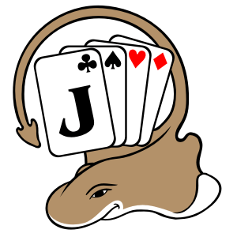

<p align="center">
  
</p>

<h1 align="center">JSkat</h1>

<p align="center">
  An open source desktop implementation of the German card game Skat.
</p>

<p align="center">
  <a href="https://github.com/b0n541/jskat/actions/workflows/ci.yml"></a>
  <a href="LICENSE"></a>
  
</p>

JSkat brings Skat to Linux, macOS, and Windows. The Java and Kotlin codebase
contains the game rules, a JavaFX desktop interface, and several computer
players—from simple opponents to algorithmic and machine learning players.

<p align="center">
  
</p>

## Help build JSkat

Contributions of every size are welcome. Some useful places to start are:

- improving or implementing an AI player;
- fixing game rule edge cases and reported bugs;
- refining the JavaFX interface;
- adding tests, documentation, or translations.

The repository includes focused modules and a Gradle wrapper, so you can get a
local development build running without installing Gradle separately.

## Get started

You need [JDK 25](https://adoptium.net/) and Git.

```bash
git clone https://github.com/b0n541/jskat.git
cd jskat
./gradlew :app:run
```

On Windows, use `gradlew.bat :app:run` instead.

Run the test suite before opening a pull request:

```bash
./gradlew test
```

## AI player tournaments

Compare built-in players and model releases with reproducible retained deals.
Random versus Algorithmic requires no models. The [headless command manual](app/TOURNAMENT.md)
provides a complete JSON example, session controls, exit codes and signal behavior.
The [developer JavaFX manual](jskat-gui/TOURNAMENT.md) describes the native workflow
available with `--developer-mode` through **Extras → Tournament…**.

See the [shared configuration and format contracts](jskat-base/TOURNAMENT.md),
[retained runs and exact-build resume](jskat-base/TOURNAMENT-STORE.md),
[ratings and interpretation](jskat-base/TOURNAMENT-RATINGS.md), and
[acceptance evidence and support limits](jskat-base/TOURNAMENT-ACCEPTANCE.md).

## Project layout

| Directory | What you will find there |
| --- | --- |
| `jskat-base/` | Game rules, application data, players, and AI implementations |
| `jskat-gui/` | JavaFX views, actions, resources, and UI tests |
| `app/` | Application entry point and distribution packaging |
| `build-logic/` | Shared Gradle conventions for the modules |
| `.scratch/` | Versioned specifications and implementation tickets for active work |

## Build a distribution

| Command | Output |
| --- | --- |
| `./gradlew clean fatjar` | Executable JAR for the current platform in `app/build/libs/` |
| `./gradlew clean installDist` | Unpacked application and start scripts in `app/build/install/JSkat/` |
| `./gradlew clean assembleDist` | ZIP and TAR distributions in `app/build/distributions/` |

On Linux, run `install-desktop.sh` from the generated installation directory to
register JSkat's name and icon with the desktop environment. You can still start
the application directly with `java -jar` when using the fat JAR.

## Contribution workflow

1. Create a feature branch from `develop`.
2. Make a focused change and add or update tests where appropriate.
3. Run `./gradlew test`.
4. Open a pull request targeting `develop`.

For ticketed work, include the ticket number in the commit subject, for example:
`#194 Add replay navigation`.

GitHub Actions builds every push and pull request on Linux, macOS, and Windows.
By participating, you agree to follow the [Code of Conduct](CODE_OF_CONDUCT.md).

## License

JSkat is available under the [Apache License 2.0](LICENSE).

Visit [jskat.org](https://jskat.org/) to learn more about the project.
